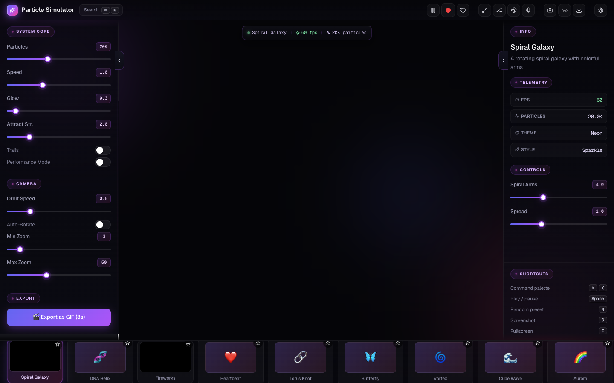
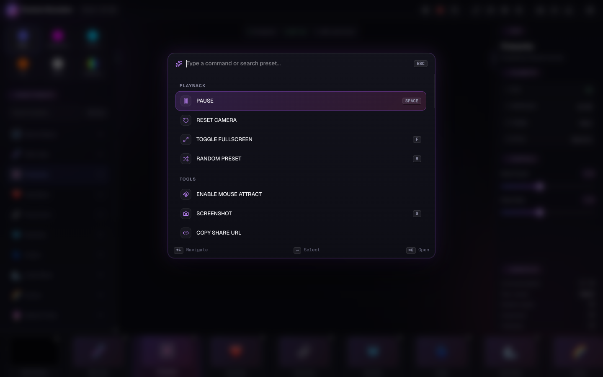
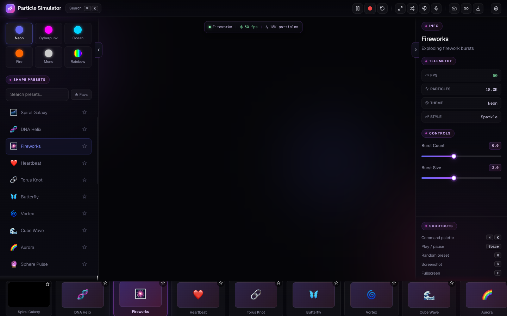

# AI Particle Simulator

[](https://sanjays2402.github.io/ai-particle-simulator)
[](LICENSE)
[](https://react.dev)
[](https://threejs.org)

A real-time 3D particle system generator powered by AI. Describe what you want, and watch 20,000+ particles come to life — wrapped in a premium command-palette driven UI.



## Features

- **40+ Built-in Presets** — Spiral Galaxy, DNA Helix, Fireworks, Heartbeat, Vortex, Aurora, Black Hole, Quantum Tunnel, Plasma Storm, Wormhole, Magnetosphere, Supernova, Fluid Vortex, and more
- **AI Text-to-Particles** — Describe any effect and AI generates the simulation code
- **Dynamic Controls** — AI-generated sliders for real-time parameter tweaking
- **6 Visual Styles** — Sparkle, Plasma, Blob, Ring, Glow, Dot rendering modes
- **11 Color Themes** — Neon, Cyberpunk, Ocean, Fire, Mono, Rainbow, Sunset, Forest, Arctic, Retro, Vaporwave
- **Gradient Palette Picker** — 2-stop custom tints with quick presets
- **Post-FX** — Chromatic aberration, vignette, film-grain noise on top of bloom
- **⌘K Command Palette** — Fuzzy-search every preset, action, and shortcut
- **? Help Overlay** — Full keyboard shortcut cheat sheet, one keystroke away
- **Debug HUD** — Toggle with backtick; live FPS / frame-time / heap stats
- **Live Telemetry** — FPS, particle count, theme, and style in the right panel
- **Mouse Interaction** — Cursor attractor, plus a Paintbrush mode that stamps persistent attractors as you drag
- **Audio Reactivity** — Bass / Mid / Treble band split with a built-in beat detector
- **GIF Export** — Record 3-second animated GIFs
- **WebM / MP4 Video Export** — MediaRecorder-based clip capture
- **URL State Sharing** — Send a v2 share URL that round-trips preset, palette, FX, and camera
- **Settings Persistence** — Quality / camera / theme survive a refresh via localStorage
- **Smash Button** — One-click random scene: preset + style + theme + camera
- **Onboarding Tour** — 4-step first-run welcome that gets out of the way
- **Mobile Drawer Layout** — Sidebars collapse to overlay drawers under 720 px
- **Double-Tap to Play/Pause** — Touch-friendly gesture on the canvas
- **Export** — Download as standalone HTML or React component code
- **60fps Performance** — Optimized for 20K+ particles with zero garbage collection

## Screenshots

### Main interface


### ⌘K Command Palette


### Theme palette with live preview


## Getting Started

```bash
# Clone the repo
git clone https://github.com/Sanjays2402/ai-particle-simulator.git
cd ai-particle-simulator

# Install dependencies
npm install

# Start dev server
npm run dev
```

Open [http://localhost:5173](http://localhost:5173) to see it in action.

## ⌨️ Keyboard Shortcuts

| Key | Action |
|-----|--------|
| `Space` | Play / Pause simulation |
| `R` | Random preset |
| `←` / `→` | Previous / next preset |
| `1`–`9`, `0` | Jump to preset 1–10 |
| `S` | Take screenshot |
| `F` | Toggle fullscreen |
| `⌘K` / `Ctrl+K` | Open command palette |
| `?` | Toggle keyboard help overlay |
| `` ` `` | Toggle debug HUD (FPS / heap) |

Double-tap or double-click the canvas to play / pause. Drag with **Paint Mode** on to stamp persistent attractors; click the brush icon again to clear them.

## AI Integration

To use the AI text-to-particle feature:

1. Click the Settings icon
2. Enter your OpenAI-compatible API key and base URL
3. Type a description in the Smart Text Engine
4. Hit **Generate**

Works with any OpenAI-compatible API (OpenAI, Anthropic via proxy, local models, etc.)

### Example Prompts

- *"A spiral galaxy with blue and purple stars orbiting a bright center"*
- *"DNA double helix rotating slowly with glowing green nucleotides"*
- *"Rain falling through fog with splashes on an invisible surface"*
- *"Fireflies in a forest at night, flickering randomly"*

## Tech Stack

- **React 18** + **Vite** — Fast dev/build toolchain
- **Three.js** + **React Three Fiber** + **Drei** — 3D rendering
- **Postprocessing** — Bloom, chromatic aberration effects
- **Tailwind CSS** — Styling
- **Zustand** — State management

## Contributing

Contributions are welcome! Feel free to open issues or submit PRs.

1. Fork the repo
2. Create your feature branch (`git checkout -b feat/amazing-feature`)
3. Commit your changes (`git commit -m 'Add amazing feature'`)
4. Push to the branch (`git push origin feat/amazing-feature`)
5. Open a Pull Request

## License

MIT — see [LICENSE](LICENSE) for details.

## Terms & Disclaimer

By using this project you agree to the following.

- **No warranty.** This software is provided "as is", without warranty of any kind, express or implied, including merchantability, fitness for a particular purpose, and non-infringement.
- **No liability.** To the maximum extent permitted by law, the author and contributors are not liable for any claim, loss, or damage (direct, indirect, incidental, or consequential, including lost data or profits) arising from its use.
- **Your responsibility.** You use it at your own risk and are responsible for complying with the laws that apply to you.
- **AI output.** Generated content can be inaccurate, biased, or offensive. Review it before relying on or sharing it. Third-party AI providers or models you use process your input under their own terms.
- **Third parties.** Names, logos, APIs, and services of others belong to their owners and are used for identification only; no affiliation or endorsement is implied.
- **Your statutory rights.** Nothing here limits rights that cannot be waived by agreement, including under consumer-protection laws in the USA, Canada (including Quebec), and India (Consumer Protection Act, 2019).
- **License.** Use, copying, and distribution are governed by the [LICENSE](LICENSE) file; if anything here conflicts with it, the license controls.

## Content, Assets & Fair Use

- **Original work.** Unless noted otherwise (including below), the code, text, design, and images in this repository were created by the author.
- **Libraries, fonts, and icons.** Third-party libraries, fonts (for example Google Fonts), and icon sets belong to their creators and are used under their own licenses; see the dependency manifests and each source for terms.
- **Logos, brands, and screenshots.** Third-party names, logos, and screenshots appear only to identify or describe their products (nominative use). They remain the property of their owners and do not imply affiliation or endorsement.
- **Ideas and inspiration.** Where this project is inspired by another product, game, or idea, it is an independent implementation. It borrows only general ideas, mechanics, or styles, which are not anyone's exclusive property, and is meant to contain no third-party code or artwork used without permission.
- **AI-generated content.** Some outputs are produced by AI models. They may resemble existing works by chance; check them before any public or commercial use.
- **Fair use and fair dealing.** Any third-party material is used in limited ways for purposes such as education, research, review, commentary, or identification, relying on fair use in the USA (17 U.S.C. § 107), fair dealing in Canada (Copyright Act, ss. 29–29.2), and fair dealing in India (Copyright Act, 1957, s. 52), where they apply.
- **Concerns and takedown requests.** If you own rights in something here and believe it is used improperly, [open an issue](https://github.com/Sanjays2402/ai-particle-simulator/issues) or contact the author through their GitHub profile with a link to the material and your claim. It will be reviewed promptly and credited, changed, or removed as appropriate. You may also use GitHub's DMCA process.
- **Contributions.** By contributing, you confirm you have the right to submit your contribution and agree it is licensed under this repository's license.
- **Website.** The project site has its own [Terms](https://sanjays2402.github.io/ai-particle-simulator/terms.html) and [Fair Use](https://sanjays2402.github.io/ai-particle-simulator/fair-use.html) pages.
